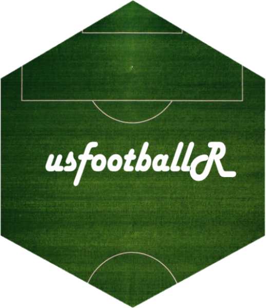
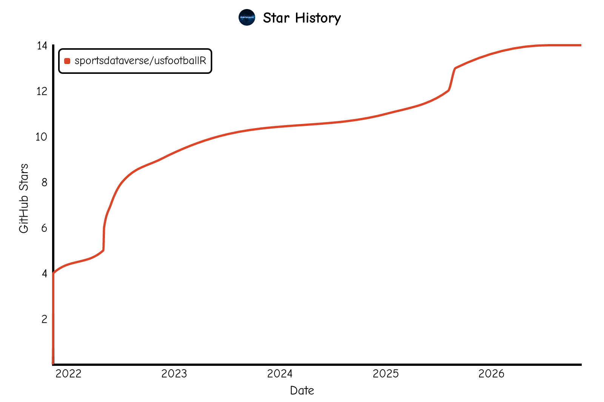

# **usfootballR** <a href='https://usfootballR.sportsdataverse.org/'></a>
```{r setup_readme, include = FALSE}
require(knitr)
if (!requireNamespace('pacman')){
  install.packages('pacman')
}
pacman::p_load(magick, grid, dplyr, lubridate)
# You can install using the pacman package using the following code:

```

<!-- badges: start -->
[](https://sportsdataverse.r-universe.dev/usfootballR)
[](https://github.com/sportsdataverse/usfootballR/)
[](https://github.com/sportsdataverse/usfootballR/actions/workflows/R-CMD-check.yaml)
[](https://github.com/sportsdataverse/usfootballR/actions/workflows/pkgdown.yaml)
[](https://lifecycle.r-lib.org/articles/stages.html#experimental)
[](https://github.com/sportsdataverse/usfootballR/blob/main/LICENSE.md)
[](https://github.com/sportsdataverse/usfootballR/graphs/contributors)
[](https://github.com/sportsdataverse/usfootballR/stargazers)
[](https://x.com/SportsDataverse)
<!-- badges: end -->

The goal of [**`usfootballR`**](https://usfootballR.sportsdataverse.org/) is to make American soccer data easy to work with in R. The package has functions to access **live play-by-play and box score** data from ESPN with shot locations when available.

A scraping and aggregating interface for ESPN's MLS and NWSL statistics. It provides users with the capability to access the API's game play-by-plays, box scores, standings and results to analyze the data for themselves.

Data freshness and pipeline status for every SportsDataverse dataset: [sportsdataverse.org/status](https://sportsdataverse.org/status).

## **Installation**

You can install the latest build from [R-universe](https://sportsdataverse.r-universe.dev/usfootballR) with:

```r
install.packages("usfootballR", repos = c("https://sportsdataverse.r-universe.dev", getOption("repos")))
```

You can install the development version of [**`usfootballR`**](https://github.com/sportsdataverse/usfootballR/) from GitHub with:

```r
if (!requireNamespace("pak", quietly = TRUE)) install.packages("pak")
pak::pak("sportsdataverse/usfootballR")
# or: remotes::install_github("sportsdataverse/usfootballR")
```

## **Quick start**

```r
library(usfootballR)

# MLS play-by-play for a season, from the SportsDataverse data repo
mls_pbp <- load_mls_pbp(2021)

# NWSL schedule for a season
nwsl_schedule <- load_nwsl_schedule(2021)

# Live from ESPN: the MLS scoreboard for a date, and the NWSL standings
espn_mls_scoreboard(season = "20200829")
espn_nwsl_standings(year = 2021)
```

## **Documentation**

For more information on the package and function reference, please see the  [**`usfootballR`** documentation website](https://usfootballR.sportsdataverse.org).

- [Function reference](https://usfootballR.sportsdataverse.org/reference/index.html)
- [News and release notes](https://usfootballR.sportsdataverse.org/news/index.html)

## **Breaking Changes**

[**Full News on Releases**](https://usfootballR.sportsdataverse.org/news/index.html)

## **Companion packages**

- [**sportyR**](https://sportyR.sportsdataverse.org/): draws MLS and NWSL pitches in `ggplot2` (`geom_soccer()`) to plot shot locations on.
- [**sdvplotR**](https://sdvplotR.sportsdataverse.org/): team logo plots in `ggplot2`, `gt` and `reactable` across the SportsDataverse leagues.

## **The SportsDataverse**

[**`usfootballR`**](https://usfootballR.sportsdataverse.org/) is part of the [SportsDataverse](https://sportsdataverse.org/), a set of
open-source packages for sports data.

| Package | Sport / Scope |
|---|---|
| [**cfbfastR**](https://cfbfastR.sportsdataverse.org/) | College football |
| [**hoopR**](https://hoopR.sportsdataverse.org/) | Men's basketball (NBA and NCAA) |
| [**wehoop**](https://wehoop.sportsdataverse.org/) | Women's basketball (WNBA and NCAA) |
| [**fastRhockey**](https://fastRhockey.sportsdataverse.org/) | Hockey (NHL and PWHL) |
| [**baseballr**](https://billpetti.github.io/baseballr/) | Baseball (MLB, MiLB, NCAA) |
| [**softballR**](https://github.com/sportsdataverse/softballR) | College softball |
| [**oddsapiR**](https://oddsapiR.sportsdataverse.org/) | Sports betting odds |
| [**recruitR**](https://recruitR.sportsdataverse.org/) | College football recruiting |
| [**usfootballR**](https://usfootballR.sportsdataverse.org/) | US soccer |
| [**cfbseedR**](https://cfbseedR.sportsdataverse.org/) · [**cfb4th**](https://cfb4th.sportsdataverse.org/) | CFB playoff simulation · fourth-down decisions |
| [**cfbplotR**](https://cfbplotR.sportsdataverse.org/) · [**sdvplotR**](https://sdvplotR.sportsdataverse.org/) · [**sportyR**](https://sportyR.sportsdataverse.org/) | Logos, colors, tables · playing surfaces |
| [**sportsdataverse-R**](https://r.sportsdataverse.org/) | Umbrella R metapackage |
| [**sportsdataverse-py**](https://py.sportsdataverse.org/) · [**sportsdataverse.js**](https://js.sportsdataverse.org/) | Python and Node.js |

See the full ecosystem at [sportsdataverse.org](https://sportsdataverse.org/).

## **Follow the [SportsDataverse](https://x.com/SportsDataverse) on X and star this repo**

[](https://x.com/SportsDataverse)

[](https://github.com/sportsdataverse/usfootballR/stargazers/)

<a href="https://github.com/sportsdataverse/usfootballR/stargazers">
  <picture>
    <source media="(prefers-color-scheme: dark)" srcset="https://raw.githubusercontent.com/sportsdataverse/usfootballR/star-history/star-history-dark.svg">
    
  </picture>
</a>

## **Our Authors**

-   [Saiem Gilani](https://x.com/saiemgilani)       
<a href="https://x.com/saiemgilani" target="blank"></a>
<a href="https://github.com/saiemgilani" target="blank"></a>

## **Code of Conduct**

Please note that the usfootballR project is released with a [Contributor Code of Conduct](https://usfootballR.sportsdataverse.org/CODE_OF_CONDUCT.html).
By contributing to this project, you agree to abide by its terms.

## **Citations**

To cite the [**`usfootballR`**](https://usfootballR.sportsdataverse.org) R package in publications, use:

BibTeX Citation
```bibtex
@misc{gilani_2021_usfootballR,
  author = {Saiem Gilani},
  title = {usfootballR: The SportsDataverse's R Package for MLS and NWSL Data.},
  url = {https://usfootballR.sportsdataverse.org},
  year = {2021}
}
```

## **License**

[MIT](https://github.com/sportsdataverse/usfootballR/blob/main/LICENSE.md) © usfootballR authors. See [LICENSE.md](https://github.com/sportsdataverse/usfootballR/blob/main/LICENSE.md).
